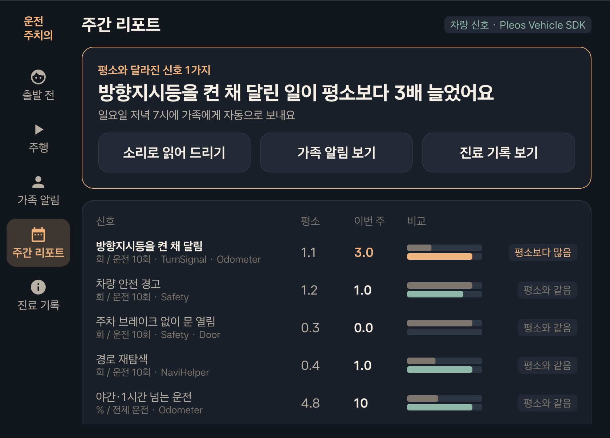
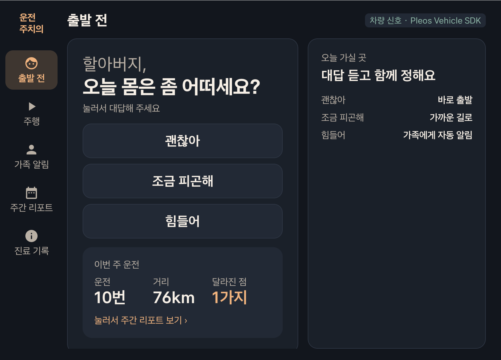
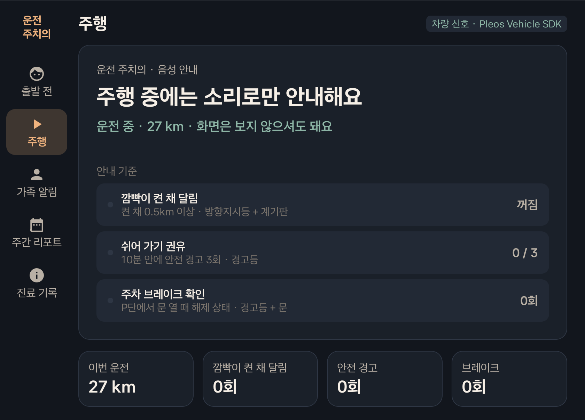
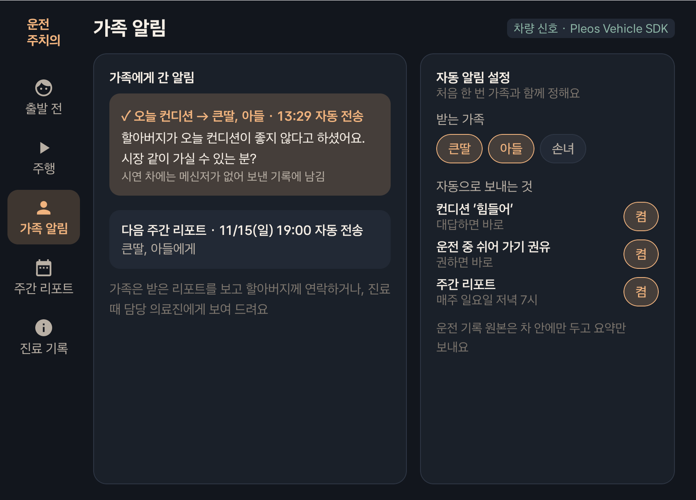
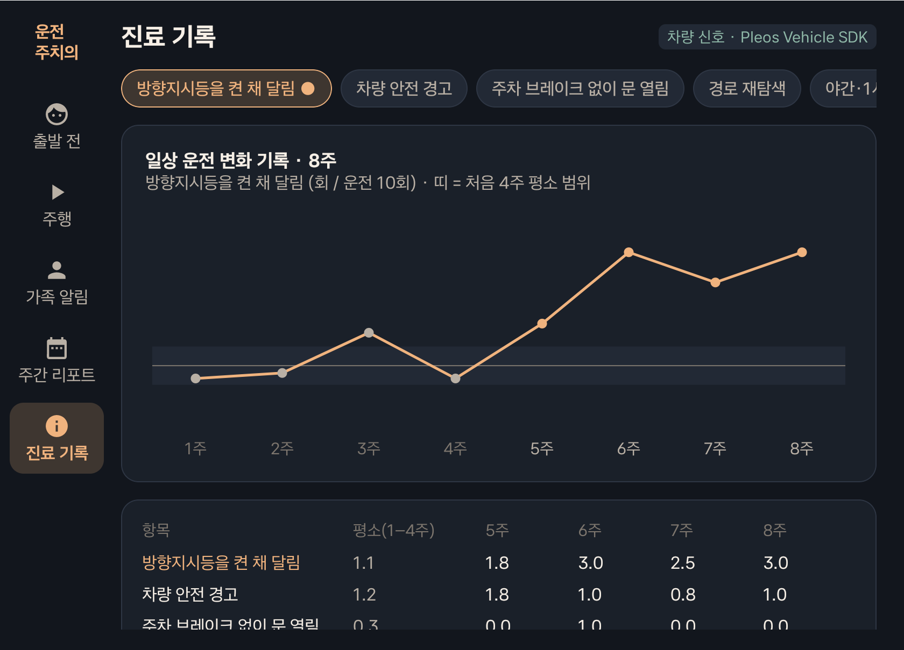

# 운전 주치의 (Driving Doctor)

고령 운전자의 운전 변화를 차량 신호로 기록하고, 본인과 가족이 함께 확인하는 Pleos Connect 차량 앱입니다.
다른 사람과 비교하지 않고, **운전자 본인의 처음 4주(평소)** 와 이번 주를 비교합니다. 진단은 하지 않고 "평소보다 늘었다"는 사실만 알려 줍니다.



## 1. 앱 소개

| 화면 | 하는 일 |
|---|---|
| 출발 전 | 시동을 걸면 "오늘 몸은 좀 어떠세요?"를 묻습니다. 버튼 또는 말로 대답하고, 대답에 따라 바로 출발 · 가까운 길을 권하고, "힘들어"면 가족에게 자동으로 알립니다. 대답까지 걸린 시간도 그날 기록에 남깁니다. |
| 주행 | 주행 중에는 화면 조작 없이 **소리로만** 안내합니다. 깜빡이를 켠 채 0.5km 넘게 달리면 "깜빡이가 아직 켜져 있어요", 10분 안에 안전 경고가 3번 울리면 "잠깐 쉬었다 가실까요?", 주차 브레이크 없이 문을 열면 "주차 브레이크를 채워 주세요"라고 말합니다. |
| 가족 알림 | 정해 둔 대로 **자동으로** 보냅니다. 컨디션 "힘들어"·운전 중 쉬어 가기 권유는 바로, 주간 리포트는 매주 일요일 저녁 7시. 받는 가족과 보낼 것은 처음 한 번 가족과 함께 설정합니다. 운전자는 누를 것이 없습니다. |
| 주간 리포트 | 6가지 신호를 평소(처음 4주)와 이번 주로 비교하고, 달라진 신호만 한 문장으로 알려 줍니다. 본인에게 먼저 읽어 줍니다. |
| 진료 기록 | 8주 변화를 선 그래프와 표로 보여 줍니다(진단 아님). 주간 리포트와 함께 가족에게 가고, 가족이 진료 때 의료진에게 보여 주거나 전달합니다. |

### 차량 신호 6가지와 Pleos SDK

| 신호 | 계산 | 쓰는 API |
|---|---|---|
| 방향지시등을 켠 채 달림 | 운전 10회당 횟수 | Vehicle · TurnSignal, Odometer |
| 차량 안전 경고 | 운전 10회당 횟수 | Vehicle · Safety(Telltale: FCA, LKA, LCA, DRIVER_ATTENTION 등) |
| 주차 브레이크 없이 문 열림 | 운전 10회당 횟수 | Vehicle · Safety(Telltale: PARKING_BRAKE), Door |
| 경로 재탐색 | 운전 10회당 횟수 | NaviHelper (2차 개발 예정, 지금은 시뮬레이터) |
| 야간·1시간 넘는 운전 | 전체 운전 중 비율 | Vehicle · Odometer |
| 브레이크 밟는 빈도 | km당 횟수 | Vehicle · Brake, Odometer |

### 변화 판정 규칙 (`domain/Baseline.kt`)

- **기준선:** 처음 4주 주간 값의 평균과 표준편차. 4주 동안 8회 미만 운전했으면 만들지 않습니다.
- **평소보다 많음:** 기준선보다 최소 차이(신호별) 이상 크고, 1.5배 이상이며, 평소 흔들림(2 표준편차)도 넘을 때
- **살펴보기:** 최소 차이 이상 크고 1.2배 이상일 때
- 줄어든 변화는 알리지 않습니다.

## 2. 실행 방법

### APK 설치
- APK 위치: [`apk/김세은_운전주치의_release.apk`](apk/)
- 에뮬레이터 창에 APK 파일을 끌어 놓거나, `adb install apk/김세은_운전주치의_release.apk`

### 실행
- **Pleos Connect Emulator(차량 서비스가 있는 기기):** 차량 신호를 Vehicle SDK에서 받습니다. 오른쪽 위에 `차량 신호 · Pleos Vehicle SDK`가 보입니다. 신호는 Pleos Connect Virtual Console로 바꿔 봅니다.
- **일반 Android 기기·에뮬레이터:** 차량 서비스가 없으면 자동으로 시뮬레이터로 돌고, `차량 신호 · 시뮬레이터`가 보입니다. 주행 화면 오른쪽의 신호 시뮬레이터 버튼이 Virtual Console 역할을 합니다.

### 시연 순서 (약 1분)
1. 출발 전: `힘들어` → 가족에게 자동 전송(화면에 보낸 기록이 바로 보임)
2. 가족 알림: 보낸 알림, 다음 주간 리포트 전송 시각, 자동 알림 설정
3. 주행: `깜빡이 켜기` → `0.2km 달리기` 3번 → "깜빡이가 아직 켜져 있어요" 음성 안내 / `안전 경고` 3번 → "잠깐 쉬었다 가실까요?"
4. 주간 리포트: "방향지시등을 켠 채 달린 일이 평소보다 3배 늘었어요" → `소리로 읽어 드리기`
5. 진료 기록: 8주 그래프와 표

> 실제 메시지 전송은 2차 단계에서 연결합니다. 지금은 자동 전송된 내용을 앱 안 `보낸 기록`에 남깁니다(`AppViewModel.autoSend`).

> 지난 8주 기록은 시연용으로 만든 기록입니다(`domain/SampleHistory.kt`, 실제 사람의 기록 아님). 주행 화면에서 `운전 마치기`를 누르면 그 운전이 이번 주 칸에 더해집니다.

### 소스에서 빌드
```bash
./gradlew :app:testDebugUnitTest   # 단위 시험 26개
./gradlew :app:assembleRelease     # app/build/outputs/apk/release/
```
서명 정보(`keystore.properties`)는 저장소에 없습니다. 없으면 디버그 키로 서명되어 누구나 빌드할 수 있습니다.

## 3. 테스트 환경

| 항목 | 값 |
|---|---|
| 확인한 기기 | Pleos Connect Emulator v2.1.0 (Android 14 · API 34), 2560 × 1440 · Android Emulator(API 34) 1920 × 720 |
| 차량 신호 | Pleos Connect Virtual Console로 Gear·Odometer·Telltale(MasterWarning, ParkingBrake)·Door 재현 |
| 앱 | minSdk 28 · targetSdk 35 · compileSdk 36, Kotlin 2.1.21, Jetpack Compose |
| Pleos SDK | `ai.pleos.playground:Vehicle:2.3.2`, `ai.pleos.playground:TextToSpeech:3.3.1` (Pleos 공개 Maven 저장소) |
| 빌드 | JDK 17, Gradle 8.11.1, Android Gradle Plugin 8.10.1, R8 축소 |
| 단위 시험 | JUnit 4, 26개 통과 (기준선·변화 판정, 주행 중 안내, 대답 해석) |

Vehicle SDK의 경고등(Telltale) 조회에는 `pleos.car.permission.PRIVATE_CAR_SAFETY` 권한 선언이 필요합니다(`AndroidManifest.xml`).
Pleos TextToSpeech SDK는 `pleos.car.permission.TTS_SERVICE` 권한과 `ko-KR` 언어 지정이 필요합니다. 차 안 음성 엔진이 없는 기기에서는 Android 기본 음성으로 바꿔 말합니다.
화면은 어르신이 읽기 쉽게 차 화면 크기에 맞춰 키우고, 보조 글씨도 18sp 아래로 내려가지 않게 했습니다.

### 성능 (Pleos Connect Emulator, 2026-11-14 측정)

| 항목 | 값 | 재는 법 |
|---|---|---|
| 앱 시작(콜드 스타트) | 1.06초 | `am start -W` 7회 중앙값, 설치 직후 상태 |
| 음성 안내 응답 | 0.24초에서 0.28초 | 말하라고 한 때부터 음성 엔진이 첫 소리를 낼 때까지(엔진 로그) |
| 화면 전환 | 끊긴 프레임 3.7% | 메뉴 5개를 두 바퀴 돌며 `dumpsys gfxinfo` |
| 대기 중 CPU | 0.1% | 30초 동안 앱 프로세스 사용 시간 |
| 메모리 | 45MB | `dumpsys meminfo` TOTAL PSS |
| APK | 9.5MB | R8 코드·리소스 축소, 실차(arm64)·에뮬레이터(x86_64)용 기계어만 |

처음 측정과 비교: 앱 시작 1.85초 → 1.06초, APK 22.2MB → 9.5MB, 메모리 62MB → 45MB (R8 축소, 앱 Baseline Profile 추가).
음성 엔진은 에뮬레이터를 켠 뒤 첫 문장에서 한국어 모델을 불러오느라 몇 초 걸리고, 그다음부터는 위 값으로 응답합니다.
측정 도구: `perf.sh`(시작·프레임·CPU·메모리)와 `voice_lat.py`(음성 응답) — 저장소 `tools/` 폴더.

## 4. 구조

```
app/src/main/java/app/drivingdoctor/
├─ vehicle/   차량 신호: VehicleEvent, PleosVehicleSource(Vehicle SDK), SimulatedVehicleSource
├─ domain/    분석: Signal(6가지 신호), Baseline·ChangeDetector(기준선·변화 판정),
│             TripSession(운전 1회 집계·음성 안내), Condition(컨디션 대답), ReportText(리포트 문장)
├─ voice/     Speaker (Pleos TextToSpeech SDK, 없으면 Android 기본 음성)
└─ ui/        화면 5개 (Jetpack Compose)
app/src/test/  단위 시험
apk/           release APK
docs/screens/  화면 캡처
```

분석 코드(`domain`)는 신호가 차량 SDK에서 왔는지 시뮬레이터에서 왔는지 모릅니다. 같은 코드가 차와 시험 환경에서 똑같이 돕니다.

## 5. 개인정보

- 운전 기록에는 이름·위치를 담지 않고 횟수·거리·시간만 담습니다.
- 가족에게는 처음 설정할 때 운전자가 허락한 요약만 자동으로 보냅니다. 운전 기록 원본은 차 안에 둡니다.
- 차를 제어하는 API(문 잠금, 공조 등)는 쓰지 않고 읽기만 합니다.

## 6. 다음 단계 (2차 발표까지)

- NaviHelper(경로 재탐색, 쉼터 안내), Pleos SpeechToText 연결
- 운전 기록 저장(차 안 로컬 DB), 가족 휴대폰으로 실제 메시지 전송(카카오 알림톡 등) 연결

## 화면

| 출발 전 | 주행 |
|---|---|
|  |  |
| **가족 알림** | **진료 기록** |
|  |  |
